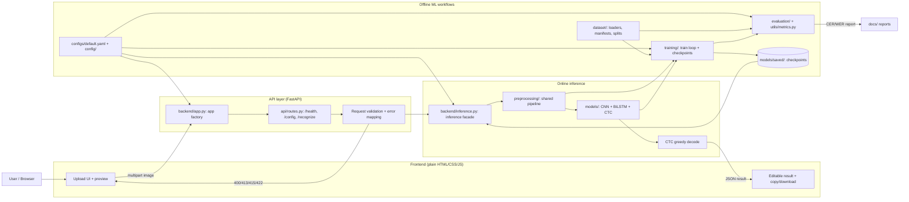
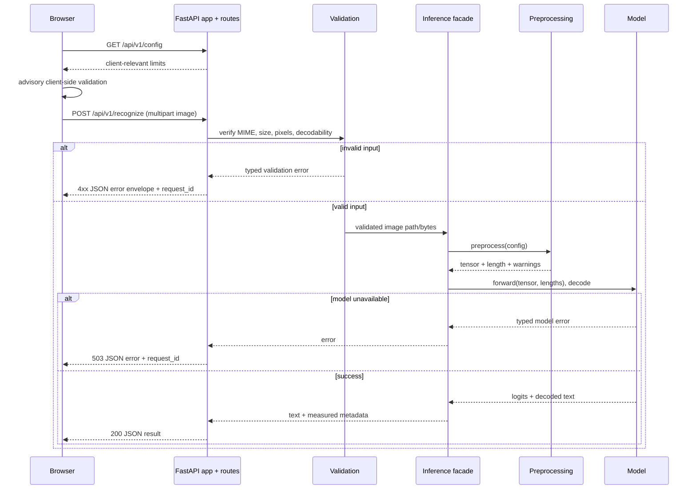
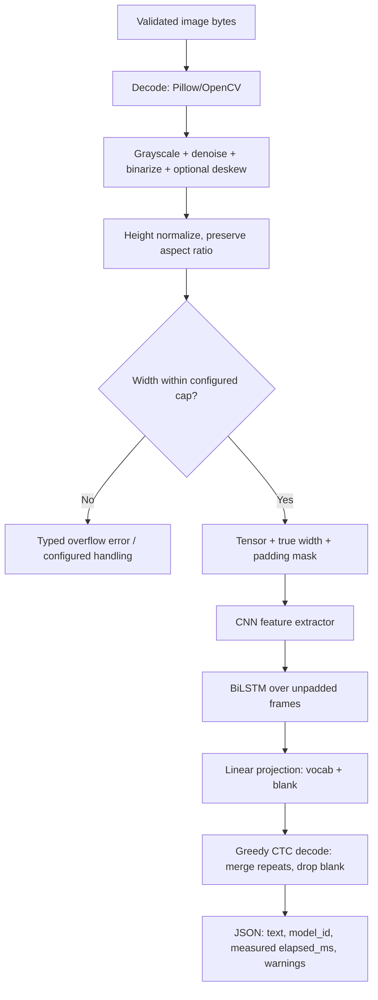
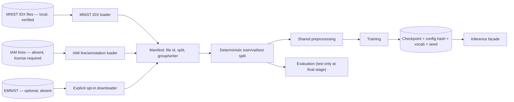

# Pen2Pixel — System Architecture

**Version:** 1.0 (Milestone 1 — proposed, pending owner approval)
**Date:** 2026-11-25
**Basis:** `docs/REPOSITORY_AUDIT.md`, `docs/REQUIREMENTS.md`, and confirmed technical decisions.
**Status:** Proposed design. At the time of writing, all application source placeholders are 0 bytes; this document specifies intended structure, not implemented behaviour.

---

## 1. Architecture Overview

Pen2Pixel is a **single-process, CPU-first web application** with a clear boundary between offline ML workflows (data preparation, training, evaluation) and online request handling (validation, preprocessing, inference, response). The web layer is stateless; the model is loaded once per process. PyTorch, OpenCV, Pillow, NumPy, and FastAPI form the confirmed runtime stack. Plain HTML/CSS/JavaScript is served from the same origin.

Design principles:

1. **Separation of concerns:** dataset, preprocessing, model, training, evaluation, inference, API, and UI each have one owner.
2. **No train/serve skew:** one preprocessing implementation is shared by training, evaluation, and inference.
3. **Config as source of truth:** paths, limits, hyperparameters, seeds, and vocabulary come from configuration, never hard-coded.
4. **Failure is explicit:** missing checkpoints, invalid images, and unavailable datasets produce typed errors; no fabricated predictions.
5. **CPU-first, device-aware:** default device is CPU; other devices are optional and must be verified before being claimed.
6. **Incremental scope:** text-line recognition now; full-page recognition as an additive future mode.

---

## 2. Component Responsibilities

The design **fills existing placeholder files in place** and adds new directories only where no placeholder exists. No existing tracked file is renamed or deleted.

| Component | Proposed location | Responsibility | Must NOT do |
|---|---|---|---|
| Configuration | `configs/default.yaml`, `config/` (new) | Load and validate config; expose typed settings; seeds; paths; limits; vocabulary. | Contain model logic or business rules. |
| Dataset pipeline | `dataset/` (existing) | IDX loader for MNIST, IAM line/annotation loaders, split manifest, download scripts with explicit opt-in, license/attribution notes. | Download data implicitly; mix splits. |
| Preprocessing | `preprocessing/` (existing: `preprocess.py`, `augment.py`) | Grayscale, denoise, binarize, deskew, height normalization, padding/mask creation; training augmentation. | Run different logic for training vs inference; resize width destructively. |
| Model architecture | `models/` (existing: `cnn_model.py`, `crnn_ctc_model.py`) | Pure PyTorch `nn.Module` definitions; device-agnostic tensors. | Load files, perform HTTP, or own training loops. |
| Training | `training/` (new) | Dataset → batches → CTC loss → checkpoints; seeds; resumability; config/vocab recording. | Serve requests; write into API code. |
| Evaluation | `evaluation/` (new) + `utils/metrics.py` (existing) | CER/WER/exact-line accuracy from shared metric functions; held-out evaluation reports. | Tune on the test split; invent numbers. |
| Inference | `backend/inference.py` (existing) | Model loading, preprocessing orchestration, decoding, request-scoped results. | Own HTTP routes; trigger training/downloads. |
| API layer | `backend/app.py` (existing), `api/routes.py` (existing) | App factory, routers, request/response schemas, validation, error mapping, static file serving. | Contain model or preprocessing internals. |
| Frontend | `frontend/index.html`, `style.css`, `script.js` (existing) | Upload UI, preview, editable result, copy/download, error display. | Hard-code fake predictions; call training endpoints. |
| Tests | `tests/` (new) | Unit tests (config, IDX parsing, preprocessing, model shapes, CTC/metrics), API tests with stub model. | Require network, GPU, or trained checkpoints. |
| Uploaded files | `uploads/` (existing, `.gitkeep` tracked) | Temporary, server-named storage for request images; configurable retention. | Be committed or used as training data without opt-in. |

### Proposed module layout (documentation only — not created in this milestone)

```text
Pen2Pixel/
├── configs/default.yaml              (new — config source of truth)
├── docs/                             (created in M0/M1)
├── handwriting-recognition/
│   ├── api/routes.py                 (fill existing placeholder)
│   ├── backend/app.py                (fill existing placeholder)
│   ├── backend/inference.py          (fill existing placeholder)
│   ├── config/                       (new)
│   ├── dataset/                      (existing; loaders + manifests + downloaders)
│   ├── evaluation/                   (new)
│   ├── frontend/                     (fill existing placeholders)
│   ├── models/                       (fill existing placeholders; saved/ ignored)
│   ├── preprocessing/                (fill existing placeholders)
│   ├── training/                     (new)
│   ├── uploads/                      (existing)
│   ├── utils/metrics.py              (fill existing placeholder)
│   └── tests/                        (new)
```

---

## 3. System Architecture Diagram



---

## 4. Data Flow

1. **Offline:** raw dataset files (local MNIST IDX; licensed IAM lines when available) are read by `dataset/` loaders. A manifest records file identity, split, and group/writer id. Split assignment is deterministic from config/seed.
2. **Offline:** images pass through the **same** `preprocessing/` pipeline used at inference; padded batches and true lengths go to the model.
3. **Offline:** `training/` optimizes CTC loss, writes checkpoints containing model state, vocabulary, config hash, and seed; `evaluation/` computes CER/WER on the held-out split only.
4. **Online:** an uploaded image is validated, written to a server-named upload path, passed through `preprocessing/`, and decoded with the loaded checkpoint.
5. **Online:** the JSON result is rendered in the editable UI; uploaded files are removed or retained per configuration.

Key invariant: no component outside `dataset/` reads dataset files, and no component outside `models/saved/` stores checkpoints.

---

## 5. API Flow



### Endpoint contract summary

| Method | Path | Purpose | Notes |
|---|---|---|---|
| GET | `/health` | Liveness and config/model availability | No dataset access; no secrets. |
| GET | `/api/v1/config` | Expose client-relevant limits | Non-sensitive values only. |
| POST | `/api/v1/recognize` | Recognize one text-line image | Multipart file; JSON result or error envelope. |

---

## 6. ML Inference Flow



Notes:

- Model loading is cached per process; request state is never shared.
- All operations are device-aware; CPU is the default and only verified target at this time.
- No confidence value is emitted unless the model actually produces one.

---

## 7. Dataset Flow



Safeguards: split membership recorded before preprocessing; writer/group-level separation to prevent leakage; test split excluded from tuning; downloads never implicit; licenses/attribution recorded before use.

---

## 8. Error-Handling Strategy

| Layer | Error class | HTTP / UI behaviour |
|---|---|---|
| Config | Missing/invalid config, missing checkpoint path | Fail fast at startup with clear log; `/health` reports unavailable; 503 on recognize. |
| Validation | Wrong MIME, oversized file, bad dimensions, blank image | Typed validation error → 400/413/415/422; inline UI message; no model call. |
| Preprocessing | Decode failure, overflow width, invalid pixel data | Typed preprocessing error → 422; warning included if processing continues with a configured policy. |
| Model / inference | Checkpoint missing/corrupt, device unavailable, inference exception | Typed model error → 503; generic client message; details logged with request ID. |
| API | Unknown route, malformed multipart, method not allowed | FastAPI defaults mapped into the same JSON error envelope. |
| Frontend | Network failure, non-2xx response | Show structured error message; preserve form state and edited text; never show invented output. |

Rules: one JSON error envelope (`error.code`, `error.message`, `error.details?`, `request_id`); no stack traces or filesystem paths in responses; structured server logs with request IDs; no swallowing of exceptions.

---

## 9. Major Technical Trade-offs

| Decision area | Choice | Rationale | Trade-off / deferred alternative |
|---|---|---|---|
| Scope | Single-line recognition first | Matches available data path and simpler evaluation. | Full-page requires layout analysis later. |
| ML framework | PyTorch only | Confirmed decision; avoids duplicate TensorFlow stack. | `tensorflow-datasets` in requirements should be removed. |
| Baseline model | CNN + BiLSTM + CTC | Proven for sequence transcription; handles variable width. | CTC independence assumption; attention/transformer deferred. |
| Image geometry | Fixed height, variable width + mask | Preserves handwriting shape; avoids distortion. | Long lines cost memory; cap required. |
| Decoding | Greedy CTC baseline | Simple, deterministic, testable. | Beam search / language model later. |
| Vocabulary | Config-derived, case-normalized uppercase baseline | Reduces class count and ambiguity. | Loses case information; must verify against IAM transcripts. |
| API boundary | `backend/app.py` factory + `api/routes.py` routers + `backend/inference.py` facade | Resolves the duplicate-responsibility ambiguity found in M0 without renaming files. | Slight indirection; three small modules instead of one. |
| Frontend | Plain HTML/CSS/JS, same-origin static files | No build step; matches confirmed stack and empty placeholders. | Less rich than React; acceptable for baseline. |
| Configuration | YAML file + typed settings | Human-readable, avoids hard-coded values. | Adds a parser dependency (PyYAML already present globally; must be declared). |
| Storage | Local upload dir, local checkpoints | Minimal infrastructure; CPU-first. | Must be abstracted before multi-instance scaling. |
| Dependencies | Pinned runtime, separate dev/test requirements | Reproducibility and smaller runtime surface. | Requires maintenance of pins. |
| Hardware | CPU-first, device-aware | Only verified target on this machine. | No GPU acceleration claims until measured. |
| Dataset acquisition | Explicit opt-in only | Licensing, disk, and RAM constraints. | Blocks IAM/EMNIST work until owner approves. |

---

## 10. Alignment with Requirements

- Functional requirements FR-01–FR-47 are realized by the components above; see `docs/REQUIREMENTS.md` §7 for milestone traceability.
- Non-functional targets (NFR-01–NFR-20) are design constraints only; none is presented as a measured SLO.
- ML requirements MLR-01–MLR-29 map to `dataset/`, `preprocessing/`, `models/`, `training/`, `evaluation/`, and `backend/inference.py`.
- Implementation, dependency installation, dataset acquisition, and test execution are explicitly **not part of this milestone**.
